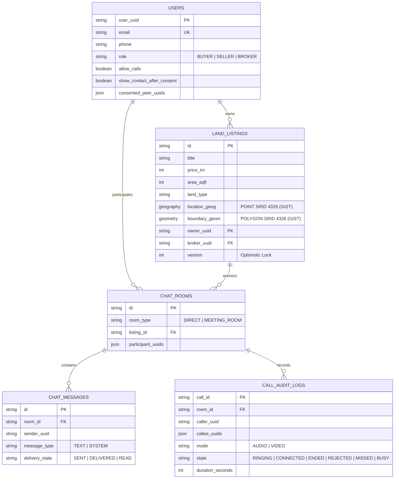
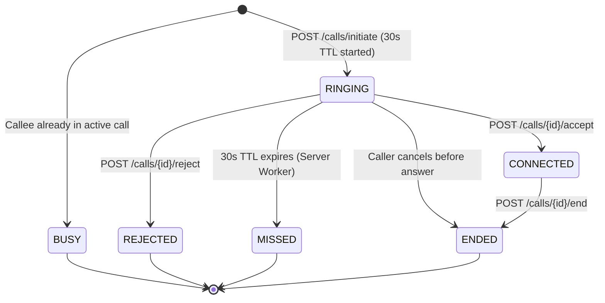
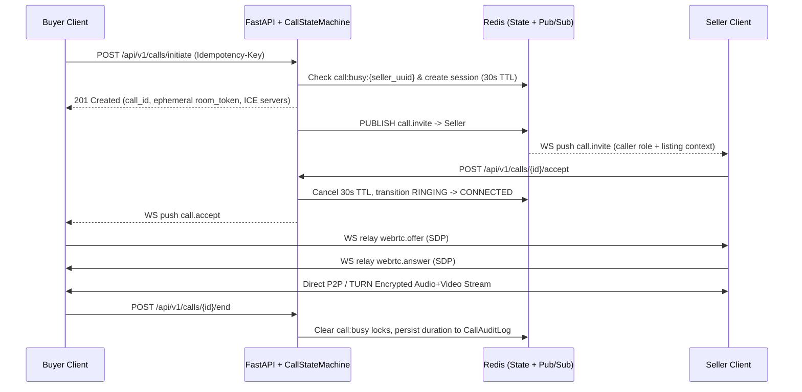

# LandConnect — Backend Architecture & System Design

## 1. System Architecture Overview

LandConnect separates stateless REST API operations, stateful real-time WebSocket signaling, PostGIS geospatial indexing, and ephemeral WebRTC media negotiation into cleanly bounded layers:

- **API & Auth Layer (`app/api/v1/`, `app/core/security.py`)**: FastAPI async routers protected by JWT Access/Refresh tokens, Argon2/bcrypt password hashing, and role-based guards (`BUYER`, `SELLER`, `BROKER`).
- **Geospatial Engine (`PostGIS + GeoAlchemy2`)**: Parcel coordinates (`Geography(POINT, 4326)`) and boundary polygons (`Geometry(POLYGON, 4326)`) indexed with GiST for sub-10ms `ST_DWithin` radius searches and `ST_MakeEnvelope` viewport queries.
- **Real-Time Pub/Sub & Calling State Machine (`Redis + WebSockets`)**:
  - Multi-worker horizontal scaling via Redis Pub/Sub (`landconnect:ws:events`).
  - Call sessions stored in Redis with busy locks (`call:busy:{user_uuid}`) and a 30-second unanswered TTL timeout worker transitioning `RINGING -> MISSED`.
  - Ephemeral 5-minute HMAC-signed WebRTC room tokens scoped to `call_id` and verified participants.
- **Privacy Layer**: Raw `phone` and `email` fields are stripped from all peer DTOs by default. Peers interact exclusively via `user_uuid` handles unless `show_contact_after_consent` is explicitly enabled for a specific peer.

---

## 2. Entity-Relationship Diagram (Mermaid)

---

## 3. Calling State Machine

---

## 4. WebRTC Signaling Sequence

---

## 5. Key Engineering Trade-offs

1. **Redis Pub/Sub + Ephemeral State vs. Database Polling**: Storing active call state and busy locks in Redis avoids Postgres row-lock contention during rapid call signaling and supports multi-worker FastAPI deployments, while PostgreSQL remains the durable audit log.
2. **WebRTC Adapter Pattern (`P2PStunTurnAdapter` vs. `LiveKitAdapter`)**: Abstracting credential issuance behind `WebRTCProviderAdapter` allows zero-cost 1-on-1 P2P calls during local evaluation and seamless cutover to a LiveKit SFU for 3+ participant Broker Deal Room video calls without altering client signaling contracts.
3. **Optimistic Concurrency (`version`) vs. Pessimistic Row Locks**: Using an integer `version` column on `land_listings` prevents lost updates when Sellers and Brokers edit a parcel concurrently, returning `409 Conflict` without holding long-lived database transactions.
4. **Geography vs. Geometry in PostGIS**: `location_geog` uses `Geography(POINT, 4326)` so `ST_DWithin` computes exact spheroidal meter distances natively around Bengaluru without manual planar projection distortion.
